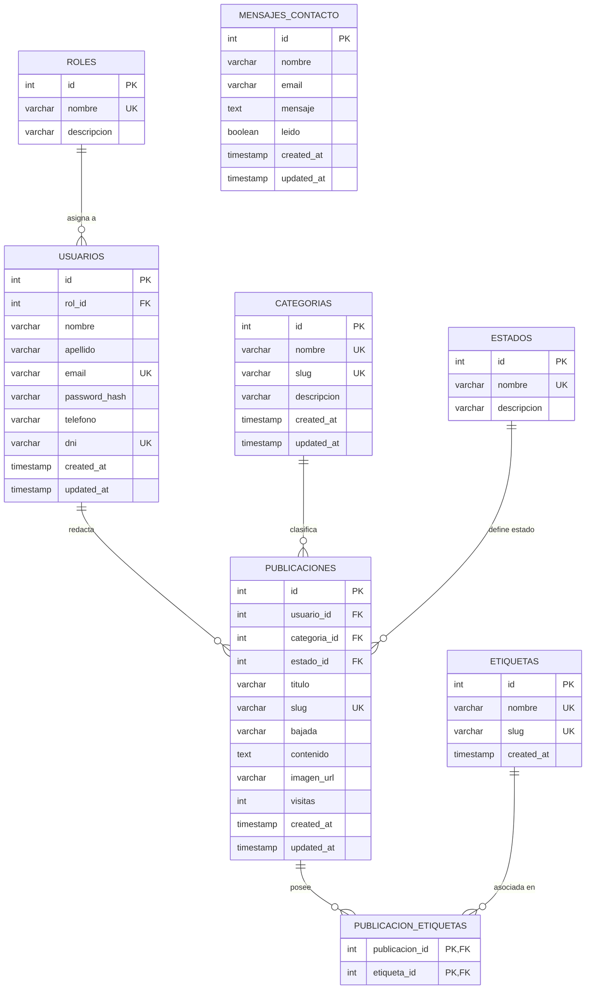

# Trabajo Práctico N° 6: Diseño, Normalización e Implementación de Base de Datos Relacional (MySQL)

**Proyecto Integrador:** Gimnasia y Tiro de Salta — Sitio Web del Hincha y Portal de Noticias  
**Autor:** Franco Guantay  
**Tecnologías:** PHP 8.x, MySQL / MariaDB (XAMPP / Laragon), Apache, HTML5, CSS3  

---

## Parte 1: Normalización Aplicada al Proyecto Integrador

El proyecto consiste en el portal web comunitario para los hinchas del **Club Atlético Gimnasia y Tiro de Salta**. El sistema gestiona publicaciones de noticias, novedades institucionales y deportivas del Albo, categorías de contenidos, autenticación de usuarios con roles (administradores, redactores, socios/hinchas), etiquetado de notas y recepción de consultas de contacto.

---

### 1. Entidad / Tabla Principal sin Normalizar

En un diseño inicial sin normalizar (modelo de hoja de cálculo o tabla plana), la información del portal de noticias se guardaría en una única tabla denominada `publicaciones_sin_normalizar`. En ella se acumulan datos del autor, datos de categorización, listas de etiquetas separadas por comas, teléfonos de contacto y estados.

#### Registro Hipotético sin Normalizar

| Columna | Valor de Ejemplo | Observación de Anomalía / Redundancia |
|---|---|---|
| `id_publicacion` | 1 | Identificador de la fila |
| `titulo` | Gimnasia y Tiro cayó en San Juan y perdió su invicto | Atributo de la noticia |
| `contenido` | El Albo cayó 3 a 1 ante San Martín en San Juan tras una racha de 8 partidos... | Texto extenso de la noticia |
| `fecha_publicacion` | 2026-11-12 10:30:00 | Fecha y hora |
| `visitas` | 1420 | Contador numérico |
| `autor_nombre_completo` | Franco Guantay | **No atómico**: combina nombre y apellido |
| `autor_email` | franco.guantay@gyt.com.ar | Correo del redactor |
| `autor_password` | $2y$10$abcdef123456... | Hash de contraseña expuesto en cada nota |
| `autor_rol` | Administrador | Rol del autor |
| `autor_telefonos` | 3874123456, 3875987654 | **Campo multivalorado**: lista separada por comas |
| `categoria_nombre` | Fútbol Profesional | Nombre de categoría repetido en cada publicación |
| `categoria_descripcion`| Noticias del plantel de Primera Nacional | Redundancia: se repite idéntica en 500 notas |
| `etiquetas` | Primera Nacional, San Martín SJ, Invicto, Gigante del Norte | **Campo multivalorado**: lista de tags en un solo campo |
| `estado_publicacion` | Publicado | Estado del post |

#### Problemas de este diseño sin normalizar:
1. **Anomalías de Redundancia:** El nombre, rol, clave y descripción de la categoría se repiten en cada noticia redactada. Si un redactor escribe 100 artículos, sus datos se duplican 100 veces.
2. **Anomalías de Modificación:** Si cambia la descripción de la categoría *"Fútbol Profesional"* o el teléfono del autor, hay que actualizar miles de filas; si una falla, los datos quedan inconsistentes.
3. **Anomalías de Inserción:** No se puede dar de alta una categoría nueva (ej. *"Básquet"* o *"Inferiores"*) ni un usuario nuevo hasta que redacten su primera publicación.
4. **Anomalías de Eliminación:** Si se borra la única noticia de una categoría específica, se pierde para siempre la existencia de esa categoría en el sistema.
5. **Dificultad de Búsqueda:** Para buscar publicaciones que tengan la etiqueta *"Invicto"*, el motor debe hacer un `LIKE '%Invicto%'` ineficiente que no puede aprovechar índices.

---

### 2. Proceso de Normalización Paso a Paso

#### Paso 1: Primera Forma Normal (1FN)

> **Definición de 1FN:**  
> Una tabla está en 1FN si y solo si:
> 1. Todos los atributos contienen valores atómicos (indivisibles, sin listas ni grupos repetitivos).
> 2. Cada columna tiene un tipo de dato único y coherente.
> 3. Existe una clave primaria (PK) que identifica unívocamente cada fila.

**Correcciones aplicadas:**
1. Descomposición del campo compuesto `autor_nombre_completo` en dos columnas atómicas: `autor_nombre` y `autor_apellido`.
2. Eliminación de los grupos repetitivos / multivalorados `autor_telefonos` y `etiquetas`:
   - El teléfono principal pasa a ser atómico a nivel usuario.
   - Las etiquetas se desacoplan de la cadena de texto plano. Para representar la relación de una publicación con sus etiquetas sin perder atomicidad, se asocia cada par `(id_publicacion, etiqueta)`.

**Estructura resultante en 1FN:**

* **Tabla `publicaciones_1fn`:**  
  `id_publicacion` (PK), `titulo`, `contenido`, `fecha_publicacion`, `visitas`, `autor_nombre`, `autor_apellido`, `autor_email`, `autor_password`, `autor_rol`, `autor_telefono`, `categoria_nombre`, `categoria_descripcion`, `estado_publicacion`.

* **Tabla intermedia `publicacion_etiqueta_1fn`:**  
  (`id_publicacion`, `etiqueta`) como Clave Primaria compuesta, donde cada fila asocia exactamente una sola etiqueta a una publicación.

---

#### Paso 2: Segunda Forma Normal (2FN)

> **Definición de 2FN:**  
> Una tabla está en 2FN si y solo si:
> 1. Ya se encuentra en 1FN.
> 2. Todo atributo no-clave depende funcionalmente de manera **completa** de la clave primaria (no existen dependencias parciales sobre partes de una clave compuesta).

**Análisis de Dependencias Funcionales:**
- En la tabla `publicacion_etiqueta_1fn` con clave primaria compuesta `(id_publicacion, etiqueta)`:
  - Si deseamos almacenar metadatos de las etiquetas (por ejemplo un identificador único, slug amigable para URL o fecha de creación), dichos atributos dependen exclusivamente de la etiqueta en sí, no de `id_publicacion`.
  - Para cumplir estrictamente con 2FN y evitar anomalías, separamos la entidad de negocio independiente `etiquetas` de la tabla de asociación.

**Estructura resultante en 2FN:**

* **Tabla `etiquetas`:**  
  `id_etiqueta` (PK), `nombre`, `slug`.
* **Tabla de relación `publicacion_etiquetas`:**  
  `publicacion_id` (PK, FK), `etiqueta_id` (PK, FK).  
  *Ambos campos forman la clave primaria compuesta y garantizan dependencia funcional completa.*
* **Tabla `publicaciones_2fn`:**  
  `id_publicacion` (PK), `titulo`, `contenido`, `fecha_publicacion`, `visitas`, `autor_nombre`, `autor_apellido`, `autor_email`, `autor_password`, `autor_rol`, `autor_telefono`, `categoria_nombre`, `categoria_descripcion`, `estado_publicacion`.

---

#### Paso 3: Tercera Forma Normal (3FN)

> **Definición de 3FN:**  
> Una tabla está en 3FN si y solo si:
> 1. Ya se encuentra en 2FN.
> 2. No existen **dependencias transitivas** entre atributos no-clave (ningún atributo que no pertenezca a la clave primaria puede depender de otro atributo no-clave: si $A \rightarrow B$ y $B \rightarrow C$, entonces $C$ depende transitivamente de $A$).

**Identificación de Dependencias Transitivas en `publicaciones_2fn`:**
1. **Dependencia del Autor:**  
   `id_publicacion` $\rightarrow$ `autor_email` $\rightarrow$ (`autor_nombre`, `autor_apellido`, `autor_password`, `autor_telefono`, `autor_rol`).  
   Los datos del autor dependen del usuario autor, no de la publicación en sí.
2. **Dependencia del Rol del Autor:**  
   `autor_email` $\rightarrow$ `autor_rol` $\rightarrow$ `rol_descripcion`.
3. **Dependencia de la Categoría:**  
   `id_publicacion` $\rightarrow$ `categoria_nombre` $\rightarrow$ `categoria_descripcion`.  
   La descripción de la categoría depende del nombre/identificador de la categoría, no del artículo periodístico.
4. **Dependencia del Estado:**  
   `id_publicacion` $\rightarrow$ `estado_publicacion`. Extraer los estados a una tabla maestra previene errores tipográficos y facilita auditoría y flujos de publicación (*Borrador*, *Publicado*, *Archivado*).

**Descomposición final en 3FN:**
1. Se crea la tabla maestra `roles` (`id`, `nombre`, `descripcion`).
2. Se crea la tabla maestra `usuarios` (`id`, `rol_id` [FK], `nombre`, `apellido`, `email`, `password_hash`, `telefono`, `dni`).
3. Se crea la tabla maestra `categorias` (`id`, `nombre`, `slug`, `descripcion`).
4. Se crea la tabla maestra `estados` (`id`, `nombre`).
5. La tabla principal `publicaciones` queda limpia de dependencias transitivas: solo almacena sus atributos atómicos y las claves foráneas hacia `usuarios`, `categorias` y `estados`.
6. Se mantiene la tabla de relación $N:M$ `publicacion_etiquetas`.
7. Se integra la tabla `mensajes_contacto` para persistir los mensajes enviados desde el formulario web (desarrollado en la Clase 5).

---

### 3. Diagrama y Listado de Tablas Resultante

#### Listado Detallado de Tablas, Claves Primarias y Foráneas

| Tabla | Clave Primaria (PK) | Claves Foráneas (FK) | Descripción de Negocio |
|---|---|---|---|
| `roles` | `id` (INT AUTO_INCREMENT) | *Ninguna* | Tipos de usuario del sistema (Administrador, Redactor, Socio, Hincha). |
| `usuarios` | `id` (INT AUTO_INCREMENT) | `rol_id` $\rightarrow$ `roles(id)` | Usuarios registrados para acceso al panel y comunidad. |
| `categorias` | `id` (INT AUTO_INCREMENT) | *Ninguna* | Secciones del portal (Fútbol Profesional, Club, Historia, Tienda). |
| `estados` | `id` (INT AUTO_INCREMENT) | *Ninguna* | Estados de ciclo de vida de un contenido (Borrador, Publicado, Archivado). |
| `publicaciones` | `id` (INT AUTO_INCREMENT) | `usuario_id` $\rightarrow$ `usuarios(id)` `categoria_id` $\rightarrow$ `categorias(id)` `estado_id` $\rightarrow$ `estados(id)` | **Tabla principal de negocio**: noticias y artículos del club. |
| `etiquetas` | `id` (INT AUTO_INCREMENT) | *Ninguna* | Palabras clave para taxonomía y búsqueda rápida de noticias. |
| `publicacion_etiquetas` | (`publicacion_id`, `etiqueta_id`) | `publicacion_id` $\rightarrow$ `publicaciones(id)` `etiqueta_id` $\rightarrow$ `etiquetas(id)` | **Tabla de relación N:M** entre publicaciones y etiquetas (con eliminación en cascada). |
| `mensajes_contacto` | `id` (INT AUTO_INCREMENT) | *Ninguna* | Mensajes enviados por hinchas desde el formulario de contacto (Clase 5). |
